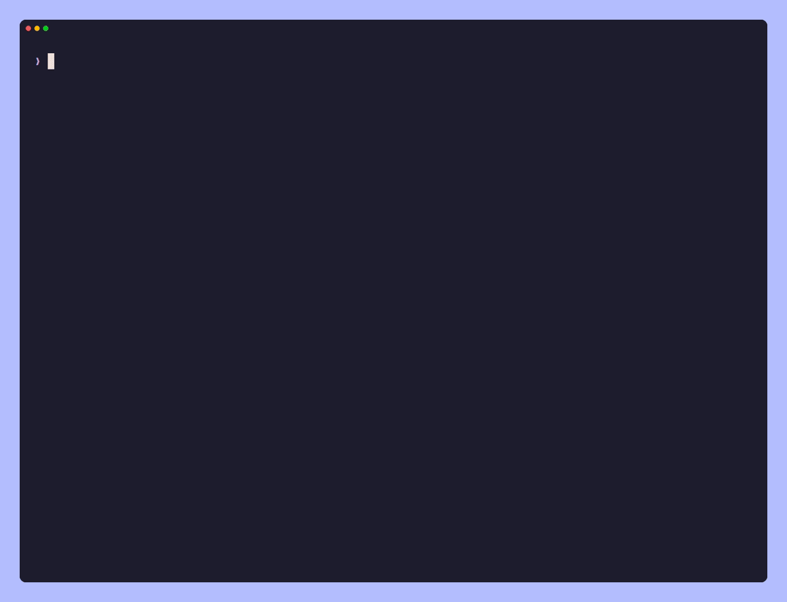

<div align="center">

# recap

A git diff that understands code.

[](go.mod)
[](https://github.com/Vaspyyy/recap/tags)
[](LICENSE)



</div>

recap reads a git diff and tells you what happened to the code in it: which functions, types, classes and Markdown sections were changed, added, removed, renamed or moved, with their line ranges and any signature that changed. Small changes show their changed lines inline, and `recap --show file:name` prints the diff of one function. It is meant as the first look at a change, before (and often instead of) reading the raw hunks of `git diff` or `git log -p`.

It was written for AI coding agents, which pay for every line they read: on real project history it came to about 3% of the text of the corresponding `git diff` and `git log -p` output. For people it adds colors and works as a readable overview before diving into a patch.

## Install

```sh
go install github.com/Vaspyyy/recap@latest
```

You'll need Go 1.26 or newer (older versions fetch the right toolchain on their own) and git. recap is a single binary. It's developed on Linux and should work on macOS and the BSDs; Windows isn't supported.

## Usage

recap takes the same kinds of arguments as `git diff`:

| Command | Compares |
| --- | --- |
| `recap` | the working tree, including untracked files, with HEAD |
| `recap --staged` | what's staged for the next commit with HEAD |
| `recap HEAD~3` | the working tree with HEAD~3 |
| `recap v1.2 v1.3` or `recap v1.2..v1.3` | two commits |
| `recap main...feature` | what `feature` changed since it branched off `main` |
| `recap show [commit]` | one commit with its parent, with the full commit message |
| `recap log -n 5` | the last five commits, one line per file |

Paths after `--` limit any of them to those files. `--show TARGET` prints the diff of the changed symbols matching `file:name`, `name` or a file; `-p` prints git's full patch after the overview; `-b N` sets roughly how many lines the overview may use (150 by default); `-A` gives plain output without colors, which is the default when stdout isn't a terminal.

`--show` takes any [ref](#refs). A location such as `internal/group/group.go:312`, as compilers, test runners and crux print it, shows the changed symbol containing that line (line numbers of the new version); if the line's symbol didn't change, recap says so and lists what did. `main.go:run@b681ef1` is the same as `recap show b681ef1 --show main.go:run`. A name finds the symbol with exactly that qualified name, else the ones ending in it (`area` finds `Circle.area`), and a class or type name shows its changed members.

## Refs

glint, seek, recap and crux name files, symbols and locations the same way, so anything one of them prints can be handed to another as is:

- `internal/files/files.go`: a file
- `internal/files/files.go:List`: a symbol, by its qualified name (`Repo.Open` for a method, `outer.inner` for a nested function)
- `internal/files/files.go:73`: a line (`73:5` with a column, `73-107` a range); tools that take a symbol use the innermost one containing it
- `main.go:run@b681ef1`: a symbol as it was in a commit; `lib.cpp:parse#2`: the second of two definitions with the same name

Paths are relative to the repository root. The format is specified in [Prism](https://github.com/Vaspyyy/prism/blob/main/docs/refs.md).

## What it reports

Every changed file gets one line with its status (modified, new, deleted, renamed, untracked, binary, lock file, generated, minified, a merge conflict) and its added and removed lines, which are git's own numbers. Below it comes one line per changed symbol:

```
money.go  modified, +11 −27
  renamed  func FormatCents → Format  L35-41  +2 −2  (public)
           was: func FormatCents(c int64) string
           now: func Format(c int64, currency string) string
  removed  func Split  was L47-57  (public; moved to split.go, 3 lines differ)
  added    func parseAmount  L14-32  (body taken from ParseCents, 2 lines differ)
           - s = strings.TrimSpace(s)
           - frac = (frac + "00")[:2]
           + frac = (frac + "0")[:2]
  changed  func ApplyRate  L44-46  +2 −2
           - return c * bp / 10000
           + return (c*bp + 5000) / 10000
  also     imports  +2 −2 (3 blank): +"fmt"
```

Each symbol line's name, after the file's path and a `:`, is a ref for `--show` (or for glint, seek and crux): `money.go:Format` above. A name that appears more than once in a file gets `#2`, `#3` and so on, counted over all of the file's definitions.

Symbols are matched between the old and new version by kind and name, so a function that changed keeps its identity. recap also follows code that moved: a definition that left one file and appeared in another is reported as a move, with whether it changed on the way, and a deleted file that reappears elsewhere with the same definitions is paired with it even when git saw a delete and a new file. A new function whose body came from an existing one, as when a helper is extracted, says so and shows the lines that differ, which is where a change hidden in a refactor usually sits. Renames are found when the body stayed the same or when a function was rewritten in place under a similar name.

Signature changes are shown as `was:` and `now:` lines, also for signatures spread over several lines, and `(public)` marks changes to the public API (exported Go names, `pub` in Rust, `export` in JavaScript and TypeScript, `public` in Java and C#, names without a leading underscore in Python; tests excluded). A new trait method without a default is marked as one every implementation has to add. Doc comments and decorators belong to the definition below them, and changes that are only whitespace, only a doc comment, only decorators or only line endings are labelled as such.

When the overview has to be cut, every file keeps its line, each file gets a share of the rest, and signature changes, renames and removals come before plain edits. What's left out is summarised by kind, for example `… +390 more changes: 390 changed (each +1 −1)`.

Symbols come from the outline rules in [Prism](https://github.com/Vaspyyy/prism) (shared with glint and seek), which cover Go, Rust, Python, JavaScript and TypeScript, C and C++, Java, Kotlin, C#, GDScript, shell, Lua, Ruby and Markdown headings. Other files get their line counts, plus the changed lines when there are only one or two.

## For coding agents

A ready-made Claude Code skill is in [`skill/SKILL.md`](skill/SKILL.md). Install it with `mkdir -p ~/.claude/skills/recap && cp skill/SKILL.md ~/.claude/skills/recap/`.

When its output isn't a terminal, recap prints plain text, so an agent can use it directly. To make it the default, add a line like this to the agent's instructions (`AGENTS.md`, `CLAUDE.md` or similar):

```markdown
- To see what changed in a git repository, prefer `recap` over `git diff` and `git log -p`: it lists which
  functions, types and sections were changed, added, removed or renamed, with signature changes
  (`recap`, `recap --staged`, `recap main...feature`, `recap show <commit>`, `recap log -n 5`).
  `recap --show file:name` prints the diff of just one symbol.
```

The intended workflow is to read the overview, then run `--show` for the few symbols whose actual change matters. On real history of three projects, recap's output was about 3% of git's:

| Command | git | recap | Saved |
| --- | ---: | ---: | ---: |
| three commits of a Go project (`git diff HEAD~3 HEAD`) | 27,599 | 2,390 | 91% |
| the last five commits (`git log -p -n 5`) | 68,563 | 2,339 | 97% |
| the last ten commits of glint (`git log -p -n 10`) | 153,980 | 1,803 | 99% |
| one small Rust commit (`git diff HEAD~1 HEAD`) | 781 | 122 | 84% |

The numbers are tokens. The savings are smallest on small diffs, where recap's labels and line ranges take about as much room as the diff itself.

Before release, recap went through three review rounds in which several models used it to describe branches and commits, write PR descriptions, release notes and commit messages, and review a refactor with a planted bug, comparing it with plain git and trying to break it. All of them found the bug from recap's overview. What they found is covered by tests that build real git repositories.

## JSON

`--json` prints one JSON document instead of the text, for programs that use recap's results: the envelope every [Prism](https://github.com/Vaspyyy/prism) tool prints, with recap's result in the shape of Prism's `report.Recap` ([format](https://github.com/Vaspyyy/prism/blob/main/docs/output.md)). It holds the two sides compared, each file with its status and line counts, each changed symbol with its ref (the same as in the text, with `#N`), signatures, and where moved or extracted code came from, the commit for `recap show`, the commits with their files for `recap log`, and with `--show` each symbol's whole diff. Paths are relative to the repository root.

It goes to stdout also when recap fails, as an error with a code (`usage`, `no_match` with the refs that did change, `ambiguous`, `failed`), and the exit code stays the same. The text budget doesn't apply: lists are complete up to 10,000 items, or `-b N` items when `-b` is given, and `truncated` says when something was cut. `-p` can't be combined with `--json`.

Text stays the default, and it's what agents should read: it says the same in far fewer tokens.

## Limits

recap compares definitions, not behaviour: it tells you that a function changed and, for small changes, which lines, but not what the change means. Definitions the outline rules don't see (Go `var` blocks, macros, configuration keys, one-line class members in JavaScript) count as lines outside definitions or as changes of the enclosing symbol. When the exact change matters, use `--show` or `git diff`.

## License

GPL-3.0. See [LICENSE](LICENSE).
